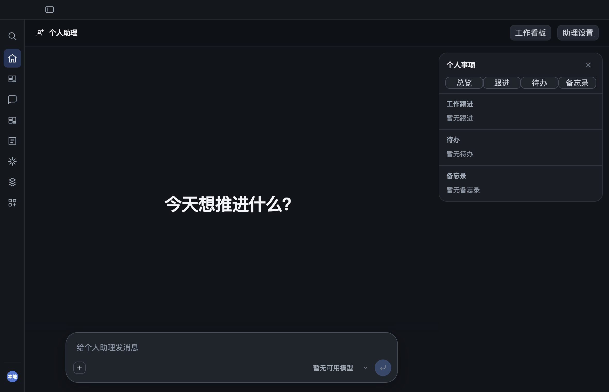
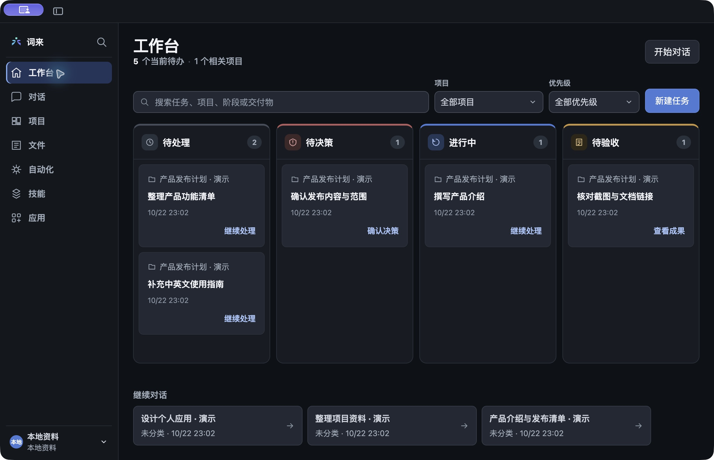
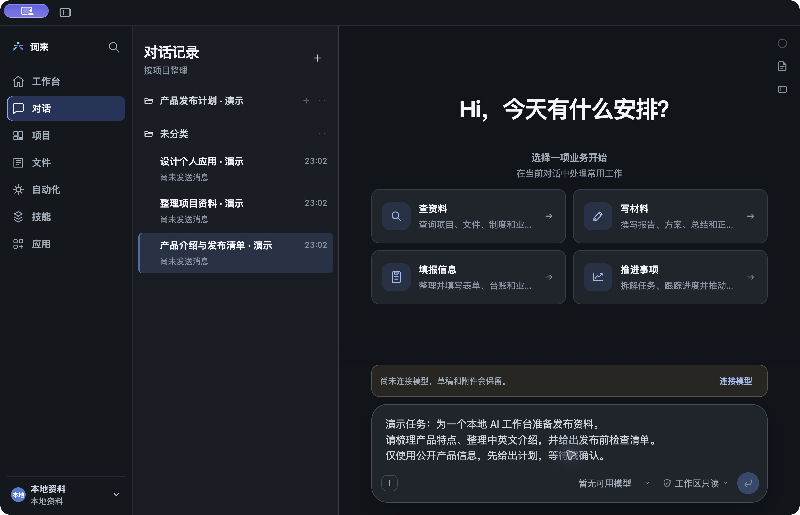

<p align="center"></p>

# 词来个人工作台

**以个人助理为中心，交办工作、跟进进展、收取成果。**

词来是基于官方 Codex CLI 的第三方桌面端，也是一个本地优先的 AI 工作台。个人助理负责协调，执行对话推进具体工作；项目、文件、工具和个人事项围绕同一目标组织。

[English](README.en.md) · [下载 v0.1.2](https://github.com/mymyme/cilai/releases/tag/v0.1.2) · [构建指南](docs/BUILDING.md) · [兼容状态](docs/COMPATIBILITY.md) · [企业版官网](https://www.cilai.com.cn) · [Apache-2.0](LICENSE)

## 个人助理

从一个目标开始，把工作交给助理，再随时回来查看进展。

- **交办工作**：新建执行对话、续接已有工作，一次交办可以拆成多项任务分别推进。
- **跟进进展**：在工作看板查看进行中、待补信息、失败和成果；补充信息送回对应工作。
- **收取汇报**：根据实际执行结果汇总进展。停止跟进和停止执行分别操作，受理与完成分别呈现。
- **管理个人事项**：手工或通过助理管理待办、重复提醒和备忘录，明确关联项目与工作。
- **保留工作上下文**：对话中断后先核对原执行，再由你主动继续；原权限和审批仍然生效。

助理使用你选择的个人模型连接。实际执行由独立工作对话承担，助理本身没有通用终端或文件写入权限。待办、备忘录和到点提醒保存在本地，提醒本身不调用模型。

**个人助理已纳入当前源码，尚未包含在已发布的 v0.1.2 下载包中。** 体验这些新增能力请[从源码构建](#从源码构建)。阅读[功能需求](docs/PERSONAL_ASSISTANT_REQUIREMENTS.md)、[架构与能力边界](docs/PERSONAL_ASSISTANT.md)、[验收标准](docs/PERSONAL_ASSISTANT_ACCEPTANCE.md)和[本地验证记录](docs/verification/personal-assistant-2026-11-17.md)。

## 下载开发预览版

**[v0.1.2 · macOS Apple Silicon](https://github.com/mymyme/cilai/releases/tag/v0.1.2)**，适用于 macOS 13.5 及以上、arm64 芯片。下载 `cilai-personal-workbench-0.1.2-macos-arm64.zip`，解压后打开应用；同页提供 `SHA256SUMS` 供核对。 macOS 13.5 是最低部署目标，尚未在 13.5 实机验收。

包内已包含锁定的官方 Codex CLI / App Server **0.163.0** 运行时，无需另装 Codex 或复用现有 `~/.codex`。模型调用仍需在工作台中配置自己的授权。

这是 **开发预览包**：使用 ad-hoc 签名，尚无 Developer ID 签名或 Apple 公证，macOS 可能阻止首次打开；自动更新禁用。当前不提供 Windows 或 macOS Intel 安装包。版本内容与限制见[发布说明](docs/releases/v0.1.2.md)。

## 界面预览

**个人助理 · 当前源码**

macOS arm64 本地测试包的实际首屏，使用全新独立资料，尚未配置模型，没有真实业务记录。



**工作台与对话 · 历史预览**

以下为 macOS 实际界面，使用已清理的临时演示资料；对话页展示尚未发送的任务草稿。





## 围绕助理的工作台

- **打开即用的本地工作台**：无需注册产品账号。本地项目、文件、历史和配置不依赖模型连接即可管理。
- **围绕项目持续工作**：对话关联工作区和文件，保留过程与产物，支持在后续会话中继续推进。
- **Codex CLI 驱动执行**：通过官方 App Server 接入持续会话、流式事件、工具执行与审批交互，适配在工作台侧完成。
- **模型连接独立管理**：提供 OpenAI API Key、官方 ChatGPT 授权、自定义 Responses 和本地模型连接入口；模型授权与本地资料归属分离。
- **工具与技能可组合**：管理技能与 MCP 连接，结合内嵌浏览器、终端和文件能力处理实际任务，执行权限由用户控制。
- **个人应用与页面 AI**：应用内嵌主窗口，按声明和授权使用页面能力，应用数据与版本分别管理。
- **自动化、审核与记忆**：新资料默认人工确认；自动审核与后台记忆需显式启用，并说明服务、历史发送范围与费用。
- **资料保护与可观察运行**：提供备份恢复、存储管理、诊断及使用量入口；API 密钥保存在工作台本地加密库。

以上能力正在按首版范围开发与验收。具体平台、模型和已知限制见[兼容状态](docs/COMPATIBILITY.md)。

## 依赖 Codex CLI

词来个人工作台的智能体执行依赖 [OpenAI Codex CLI](https://github.com/openai/codex)，通过官方 [Codex App Server](https://developers.openai.com/codex/app-server/) 的公开协议集成。

- 当前锁定官方 **Codex App Server 0.163.0** 完整发行件；版本、下载来源和摘要见[运行时清单](third_party/openai-codex.release.json)。
- 普通构建会准备并校验这一发行件，不要求复用你在系统中安装的 Codex CLI，也不编译保留的旧版源码快照。
- Codex 使用个人版专属配置与状态目录，不读取或复制用户现有 `~/.codex` 的配置、认证、历史或记忆。
- 工作台负责界面、本地资料、连接与权限适配，保持官方 Codex 源码与算法不变。

模型接入仍需要用户自己的有效授权。连接目录可读、普通问答成功、流式可用和工具兼容分别验证；费用与账号权限由服务供应商决定。

## 从源码构建

也可从源码构建本地测试包。请先准备：

| 工具 | 版本或要求 |
| --- | --- |
| Node.js | **24.18.0**，包含 npm |
| Rust | **1.97.1**，含 clippy / rustfmt |
| macOS | Xcode Command Line Tools；Swift / PDFKit / AppKit |
| Windows | Windows 10 22H2 x64 或后续客户端 x64，PowerShell 5.1+、MSVC C++ Build Tools、Windows SDK、CMake |
| 完整质量检查 | cargo-deny **0.20.2** |

构建器目前要求源码位于 `06代码索引/cilai-workbench`。按下面的相对布局克隆，构建和运行目录会保持独立：

```sh
git clone https://github.com/mymyme/cilai.git cilai-personal/06代码索引/cilai-workbench
cd cilai-personal/06代码索引/cilai-workbench
node --version
npm run check:toolchain
node scripts/personal-build.mjs
npm run check:conversation-package
npm run package
```

上述 npm 命令可在 macOS 终端或 Windows PowerShell 执行。`npm run package` 会在独立构建根内按锁文件安装依赖、构建界面与本地服务、准备官方运行时，并执行个人版无模型启动检查。

```text
cilai-personal/
├── 06代码索引/cilai-workbench/   # 当前仓库
└── .personal-run/               # 源码运行资料
```

构建暂存、依赖、缓存和本地测试包固定放在用户主目录下 `~/.cilai-personal-builds/desktop`，不参与源码目录的 iCloud 等云同步。

启动使用 `npm run launch`。重建前正常退出正在运行的个人测试包。详细输出路径、检查入口与平台前提见[构建指南](docs/BUILDING.md)。

## 当前状态

项目处于 **开发预览**，已提供 v0.1.2 macOS arm64 下载包。首版仍在验收，尚无 Developer ID 签名或 Apple 公证发行。

| 范围 | 当前记录 |
| --- | --- |
| macOS arm64 | 本地包构建、无模型启动及重启恢复已有验证 |
| 自定义 Responses | Agnes / `agnes-3.0-flash` 已完成一次八项完整验证 |
| macOS Intel / Windows | 目标平台；原生包与业务验收仍待完成 |
| OpenAI API / ChatGPT 授权 / 本地模型 | 已有接入实现，真实授权与具体兼容组合仍待验证 |

[兼容状态与已知缺口](docs/COMPATIBILITY.md)区分实现、模拟检查、构建和真实调用，不将一项通过推广到所有模型或平台。

## 项目结构

```text
apps/desktop-ui/     React + TypeScript 界面
apps/desktop/        Electron Shell 与 Rust Host
crates/             领域、应用、持久化、协议及运行时
packages/app-ui/    内置共享界面组件源码
migrations/         本地数据库前向迁移
schemas/            接口契约
scripts/            构建、依赖准备与验证
third_party/        官方运行时清单、通知与历史源码快照
```

设计边界见[架构说明](docs/ARCHITECTURE.md)，依赖与归属见[第三方说明](docs/THIRD_PARTY.md)。

## 企业版

需要了解企业版，请访问 **[词来官网 · www.cilai.com.cn](https://www.cilai.com.cn)**。

个人开源版聚焦本地个人工作流，独立于企业账号、云空间和企业协作系统。“个人版”描述产品功能范围，不限制企业或商业使用；第三方服务的授权与条款分别适用。

## 许可证与贡献

第一方源码及资源使用 **[Apache License 2.0](LICENSE)**，归属说明见 [NOTICE](NOTICE)。Codex、Node、Electron、PDF.js 等第三方组件保留各自许可证和必要声明。

欢迎通过 [Issues](https://github.com/mymyme/cilai/issues) 反馈问题，或提交 Pull Request。反馈时请注明平台、应用与运行时版本、复现步骤，并移除密钥、个人资料和敏感日志。
