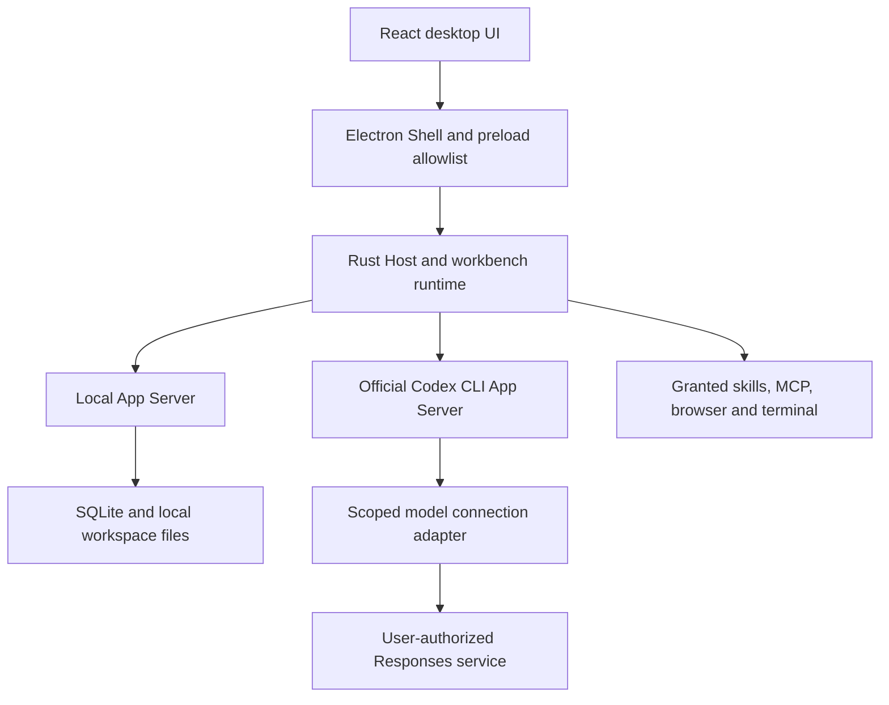

# 架构 / Architecture

Cilai Personal Workbench provides a local desktop interface around the official Codex CLI App Server. Local data ownership belongs to a stable local profile and does not change when a model connection or model account changes.

## Responsibilities

- **UI:** project and file navigation, persistent conversations, model connection settings, approvals, personal apps, and operational views.
- **Electron Shell:** trusted application lifecycle, embedded browser and app frames, native dialogs, and a narrow preload interface. App content receives declared App Bridge capabilities rather than generic Node or host IPC access.
- **Rust Host / runtime:** orchestrate model and tool execution, immutable authorization snapshots, approvals, execution leases, and lifecycle coordination.
- **Local App Server:** the sole business-state and SQLite writer. UI and CLI do not write the database directly.
- **Domain / application crates:** shared business rules independent of Electron and platform-specific APIs.
- **Platform adapter / local transport:** platform-specific process, security, filesystem, and IPC behavior. Native implementations and validation are tracked separately for macOS and Windows.

## Codex integration

The pinned official App Server distribution is prepared from [the runtime manifest](../third_party/openai-codex.release.json). Workbench-side adaptation uses the public protocol; the project does not modify upstream Codex algorithms or build the retained historical snapshot for normal execution. Dedicated Codex homes isolate credentials, native threads, and memory from existing installations.

Model directories, credentials, inference, streaming, and tools have distinct validation states. A passing model-list request is not treated as inference authorization. Changing a connection does not silently change a model, provider, protocol, or local data ownership. Cross-connection continuation must respect native-thread and history-sharing boundaries.

## Permissions and data

New local profiles default to manual approval. Automatic review and background memory require explicit consent tied to the actual service and allowed history scope. User-facing completion, native process exit, execution leases, and maintenance writers are separate facts; unknown outcomes remain visible and do not authorize automatic repetition of side effects.

Model, network, and MCP credentials use separate namespaces in the workbench's local encrypted vault. Official ChatGPT authorization uses the official runtime's isolated authentication lifecycle. Backups exclude secrets and authentication state, and restoration must preserve usable source data on failure.

## State ownership and background work

Project views own state for one project and workspace. Read generations and mutation revisions prevent late responses from replacing newer state; responses from a closed view cannot update a different project. Draft execution choices retain both the model and its connection. Older drafts without a recorded connection require an explicit selection.

The runtime retains proposed session values while a ledger write has an unknown outcome. It confirms the original idempotent command before accepting later persistence work; only a confirmed rejection restores the previous values. Native thread metadata synchronization selects changed or uncached conversations and batches catalog reads by runtime scope. UI snapshots project the permitted fields directly without first copying discarded tool context and logs.

The host checks queued follow-up work on a periodic deadline even while commands continue arriving. Conversation occupancy and maintenance checks still govern admission. Personal page actions share one timing contract between Electron and Rust: a 60-second execution budget plus 10 seconds for the host callback, while other callbacks retain their existing limits. A timeout remains an unconfirmed outcome and never authorizes repeating an action.

The selected data environment crosses the shell-to-host boundary only as a validated explicit startup value. Inherited environment variables cannot select another data environment or reintroduce enterprise configuration.

Model catalog state and its refresh notifications have a dedicated runtime owner. Session persistence keys and request types come from the protocol generator. Purpose-specific runtime queries project only the requested operational scope; a full conversation or run detail is a separate read. SQLite workspace/file, project/deliverable and task repositories own their respective transaction implementations, with the Local App Server remaining the only business writer.

Host routing classifications are declared once in `apps/desktop/host-commands.json`. The generator produces the JavaScript and Rust classification tables, and tests reject stale output or disagreement with real handlers. Business dispatch, caller-window validation, personal-edition restrictions and App Server method authorization remain explicit at their enforcement points.

## Local text search

Workspace observation builds a content-versioned text index outside the business service lock. The existing safe text reader verifies workspace containment, opened-file identity and the observed checksum before accepting complete UTF-8 text (including BOM) of at most 2 MiB. Hidden paths are excluded. Binary content, other encodings and oversized files have explicit index classifications; read failures fail indexing and are never stored as successful text.

The private profile database stores shared content versions and an FTS5 trigram index. Identical content is indexed once, pending text has a bounded batch budget, and search joins the index to currently materialized workspace files by SHA-256. Renames retain current paths; replaced or deleted files cannot match an obsolete content version after observation commits. Existing files are backfilled during the normal initial workspace rescan. Literal two-character searches remain supported; FTS5 cannot accelerate such short substrings. This cache is profile-local and never supplies a separate file-access authority.

## Local MCP isolation

Arbitrary local MCP commands on Windows, macOS child-process permission and local-command proxying remain explicitly unavailable where the required isolation cannot be enforced. A Job Object or a process group alone is not a filesystem/network sandbox. The implementation requirements and independent native acceptance criteria are recorded in [MCP sandbox boundaries](MCP_SANDBOX.md).

## Product and distribution boundaries

The personal edition includes local projects, files, conversations, skills, personal apps, browser, terminal, notifications, and the necessary permission controls. Enterprise accounts, cloud workspaces, enterprise collaboration and publishing, capture, pairing, reception, and transcription services are outside this edition.

First-party source is Apache-2.0. Third-party components retain their licenses. Local testing packages use a distinct identity and empty update source. Current implementation gaps and unverified combinations are listed in [compatibility](COMPATIBILITY.md).

## Search consistency and index lifecycle

Each scan holds a shared indexing lease until all file-observation batches have committed. Content versions without current visible-file references are reclaimed only when no scan is in flight; the in-memory version set is invalidated in the same cleanup. Startup and subsequent scans reclaim interrupted-scan leftovers. Backup sanitization removes the derived text/index tables and vacuums the snapshot rather than allowing cached content to bypass the user's original-file selection.

Search uses a separate read-only SQLite connection owned by the Local App Server. Each candidate batch releases its database read transaction before file verification; both search entry points release the business service lock before this work. Workspace root identity and canonical location, file identity, size and full checksum are checked before a body hit is returned. Stale candidates are filtered and keyset scanning continues; real unreadable-source errors explicitly mark the result incomplete. This narrows stale-result exposure without granting access from cached content.

## Runtime admission and projections

The model catalog owner keeps the catalog, check time, generation, revision, errors and refresh notifications together without a second cached model list. The session owner keeps session identity and revision; durable session values still participate in the existing ledger transaction. Protocol generation supplies both session request types and the frontend persistence-key declaration. Profile reset preserves the subscription channel while retiring the previous state.

The run-state owner updates streamed output, event merging, context usage and the bounded log tail. The persisted aggregate records a steered message, conversation time and run event together. The manager retains the existing mutex, native-thread bindings, admission, persistence and scheduler wake-up. These owners do not create another database, lock or commit path.

Purpose queries select borrowed records under one current-profile lock and then project their permitted fields. Automation and incident readers receive run summaries, with the full retry chain retained for incident attribution. Project reads are project-scoped; work reads select relevant user inputs and bounded result previews. Archive lists contain metadata, while conversation and run details are separate reads. A query does not refresh the native catalog or execute a model, rule or tool. Invalid targets fail explicitly rather than expanding to all history.

Send preparation freezes the model execution lease, preflight evidence and authorized review/memory scopes before admission. A separate locked preparation object must borrow the manager's still-held mutex guard to check current uploads, retry input, regeneration history, model modalities, skill snapshots and task candidates. Its owned result carries the run policy and execution materials; it cannot authorize new capabilities or publish a message or run. Existing execution-lease checks still apply before launch.

The manager preserves the order of native-thread recovery, acknowledged-steer recovery, run acceptance, approval consumption and ledger commit under the original lock. Launch follows confirmed persistence; an unknown outcome is reconciled with the original idempotent command. The enterprise-tool rejection remains at the send entry point. Removing unreachable enterprise-tool construction does not change personal-app or local-tool approval boundaries.

The manager still coordinates application execution, harness registration and queueing, run completion and send transactions. Dedicated state owners reduce coupling but do not establish that all runtime orchestration has been separated.

## Frontend state and preview owners

The project data hook owns scoped project reads, request generations and confirmed-mutation revisions. The project view owns interaction state, while overview, attention and plan components receive explicit data and actions. The conversation snapshot hook owns refresh serialization, callers waiting for a fresh result, archive revisions and activity polling. Display formatting, attachments and run-process/detail views have separate modules. These boundaries preserve one owner for each asynchronous state transition rather than adding a second state store.

File preview loads when a file is opened. Shared source/error labels are separate from renderers, so reading a label or mounting the workspace shell does not load Markdown or Office rendering. Production chunks separate React and Markdown code from frequently changed application entry code; Mermaid and document engines remain demand-loaded. Large indivisible upstream layout modules remain visible in build warnings.

Office package validation and calculation run in a disposable worker with archive, XML, nesting, object, formula-reference and time limits. Package XML helpers resolve internal relationships without granting external resource access. The chart parser owns stored series/category/axis data; the chart view draws supported data as SVG. The diagram parser resolves saved SmartArt drawing relationships and coordinate bounds, while the existing slide renderer draws the resulting shapes and text. Missing computed layout and unsupported graph semantics become explicit object errors.

The workbook calculator owns typed cell inputs, dependency recursion, cycle detection, shared-reference translation and calculation errors. It uses the pinned MIT JavaScript formula engine with a bounded parser pool, without native platform dependencies or network formula execution. Cached cell values are retained as provenance only. Successful scalar results replace displayed cached values; unsupported formulas and date-system semantics remain visible failures. The UI reports formula error counts and exposes calculation/cached values for inspection. This capability does not create an Office editor or claim complete Excel or PowerPoint fidelity.

## MCP capability presentation

Tool settings receive the trusted host-platform result through the existing main/settings properties; they do not infer capabilities from the browser user agent. Unsupported local sources, child-process grants and local proxy combinations cannot be newly selected or validated. Existing configurations and validation history remain visible until the user explicitly changes them. UI restrictions describe current capability; platform isolation and execution-lease validation remain the enforcement boundary.

## 构建与验证产物生命周期

个人构建根固定于用户主目录下的 `.cilai-personal-builds/desktop`，与企业版目录隔离且不参与源码云同步。共享定位模块为构建脚本、Electron 开发宿主及 Rust 测试提供一致的根；暂存目录只接受显式登记的源码和项目归属，不通过父级层数推断。旧云目录退役后只保留历史资料，迁移按独立回执保留缓存 inode，不改写历史验证记录。

构建锁管理本轮临时目录、空间报告与独立缓存。受管备份按数据集登记，由数据所有者提供源写保护，完整校验通过后轮换旧副本。运行中应用、企业工程、未登记数据和系统内容不进入清理范围。详见 [构建空间管理](BUILD_STORAGE.md)。

根构建、根测试及公开的产物型验证经受管验证适配层取得或继承同一构建锁并校验冻结清单；嵌套调用复用暂存输入。验证现场的生命周期与业务备份独立，初始化失败保留诊断，完整备份仍由真实数据写保护协议准入。
