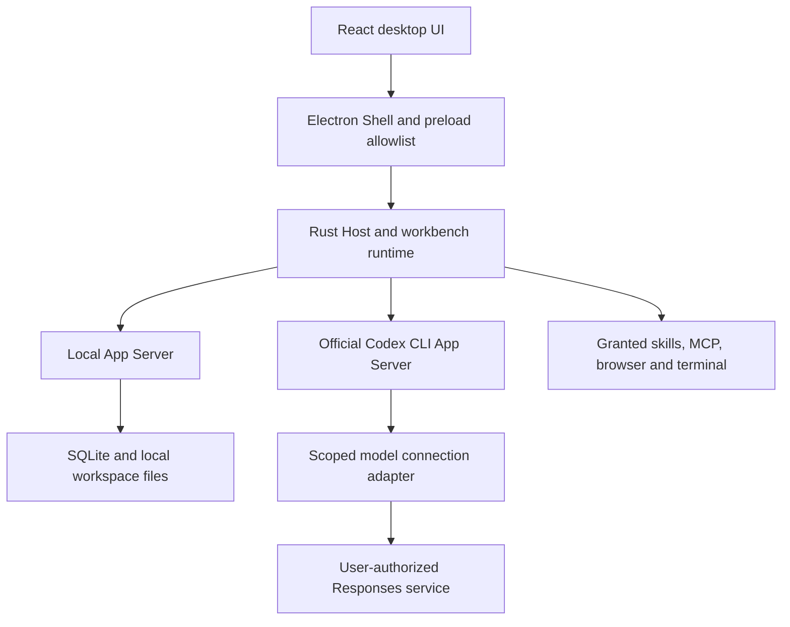

# 架构 / Architecture

Cilai Personal Workbench provides a local desktop interface around the official Codex CLI App Server. Local data ownership belongs to a stable local profile and does not change when a model connection or model account changes.

## Responsibilities

- **UI:** project and file navigation, persistent conversations, model connection settings, approvals, personal apps, and operational views.
- **Electron Shell:** trusted application lifecycle, embedded browser and app frames, native dialogs, and a narrow preload interface. App content receives declared App Bridge capabilities rather than generic Node or host IPC access.
- **Rust Host / runtime:** orchestrate model and tool execution, immutable authorization snapshots, approvals, execution leases, and lifecycle coordination.
- **Local App Server:** the sole business-state and SQLite writer. UI and CLI do not write the database directly.
- **Domain / application crates:** shared business rules independent of Electron and platform-specific APIs.
- **Platform adapter / local transport:** platform-specific process, security, filesystem, and IPC behavior. Native implementations and validation are tracked separately for macOS and Windows.

## Codex integration

The pinned official App Server distribution is prepared from [the runtime manifest](../third_party/openai-codex.release.json). Workbench-side adaptation uses the public protocol; the project does not modify upstream Codex algorithms or build the retained historical snapshot for normal execution. Dedicated Codex homes isolate credentials, native threads, and memory from existing installations.

Model directories, credentials, inference, streaming, and tools have distinct validation states. A passing model-list request is not treated as inference authorization. Changing a connection does not silently change a model, provider, protocol, or local data ownership. Cross-connection continuation must respect native-thread and history-sharing boundaries.

## Permissions and data

New local profiles default to manual approval. Automatic review and background memory require explicit consent tied to the actual service and allowed history scope. User-facing completion, native process exit, execution leases, and maintenance writers are separate facts; unknown outcomes remain visible and do not authorize automatic repetition of side effects.

Model, network, and MCP credentials use separate namespaces in the workbench's local encrypted vault. Official ChatGPT authorization uses the official runtime's isolated authentication lifecycle. Backups exclude secrets and authentication state, and restoration must preserve usable source data on failure.

## Product and distribution boundaries

The personal edition includes local projects, files, conversations, skills, personal apps, browser, terminal, notifications, and the necessary permission controls. Enterprise accounts, cloud workspaces, enterprise collaboration and publishing, capture, pairing, reception, and transcription services are outside this edition.

First-party source is Apache-2.0. Third-party components retain their licenses. Local testing packages use a distinct identity and empty update source. Current implementation gaps and unverified combinations are listed in [compatibility](COMPATIBILITY.md).
