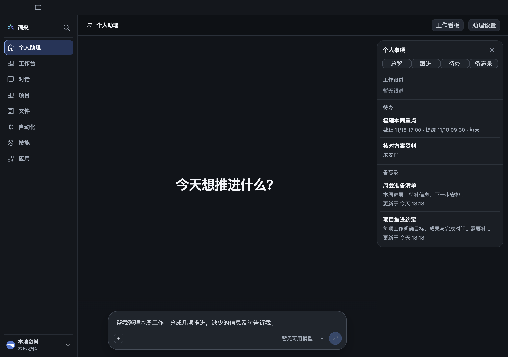

# Cilai Desktop v0.1.3 · 个人助理 / Personal assistant

## 更新内容

- 新增个人助理入口，支持新建和续接执行对话、批量交办、工作跟进及基于实际结果的主动汇报。
- 新增个人事项：待办、单次/每日/每周提醒、稍后提醒和备忘录；手工管理与助理操作使用同一组本地记录，到点提醒不调用模型。
- 工作看板区分进行中、待补信息、阶段结果与成果；停止跟进和停止执行分别操作。
- 中断后先核对原执行与工具回执，再由用户主动继续；相同来源只建立一个直接后续执行，未知写入阻止重复操作。
- 模型选择区分跟随默认与显式档位；同步流式正文、工具进度、正式结果回执、按能力声明启用的公开思路，以及任务工具范围限制。
- 个人应用临时对话支持清空和重新开始，重复请求复用同一替换会话；更新统一 PDF 预览、复制反馈、窄窗口和启动流程。
- 更新 Electron 至 44.10.2、rusqlite 至 0.41.0；官方 Codex CLI / App Server 保持 0.163.0。

## 当前界面

v0.1.3 macOS arm64 实拍，左侧主导航展开，使用全新独立演示资料。待办和备忘录为手工录入，交办草稿未发送，没有模型生成的演示结果。

## 下载

下载 `cilai-personal-workbench-0.1.3-macos-arm64.zip` 与 `SHA256SUMS` 到同一目录，运行 `shasum -a 256 -c SHA256SUMS`，再解压打开应用。

- 平台：macOS 13.5 及以上、Apple Silicon（arm64）。最低部署目标不等于 macOS 13.5 实机验收。
- 包内包含官方 Codex CLI / App Server 0.163.0，无需另装 Codex 或复用现有 `~/.codex`。
- 模型调用需要用户自己的有效授权。新资料无需产品账号即可管理本地记录。
- 本包使用 ad-hoc 签名，没有 Developer ID 签名或 Apple 公证；自动更新关闭。

## 验证与边界

个人助理增量的本地验证包含 1376 项前端、1343 项 Rust（整轮与复验去重）、22 项真实 Electron 检查，以及完整 Node/Shell/构建检查和启动就绪专项；条件跳过与证据层分别记录，见[验证记录](https://github.com/mymyme/cilai/blob/v0.1.3/docs/verification/personal-assistant-2026-11-17.md)。版本发布另核对源码提交、独立资料启动、随包组件、归档、签名及公开下载摘要。

本轮未重做真实供应商付费调用。Windows、macOS Intel、最低系统实机、系统通知实际送达/点击、完整业务组合及正式签名分发仍须独立验收。页面 AI SDK 的真实 Electron 检查使用合同服务夹具，不等于真实模型或完整应用验收。已有个人应用需主动接入临时对话重启接口。

官网：[www.cilai.com.cn](https://www.cilai.com.cn)

---

## Changes

- Added a personal assistant for starting or continuing work conversations, batch delegation, follow-up, and updates based on actual results.
- Added local todos, one-time/daily/weekly and snoozed reminders, and memos. Manual and assistant operations share the same records; scheduled reminders do not call a model.
- The work board distinguishes active work, missing information, stage results, and artifacts. Stopping follow-up and stopping execution are separate actions.
- Explicit continuation checks the original execution and receipts first. A source run has one direct continuation, and uncertain writes block duplicate execution.
- Added model-default reasoning selection, streamed text and tool progress, formal-result receipts, capability-declared public notes, and scoped task tools.
- Added temporary app-conversation reset with idempotent replacement, unified PDF preview, copy feedback, narrow-window improvements, and startup readiness checks.
- Updated Electron to 44.10.2 and rusqlite to 0.41.0. The official Codex CLI / App Server remains at 0.163.0.

## Download and limits

Download `cilai-personal-workbench-0.1.3-macos-arm64.zip` and `SHA256SUMS` into one directory, run `shasum -a 256 -c SHA256SUMS`, then extract and open the app. This preview targets macOS 13.5 or later on Apple Silicon. It bundles the official Codex runtime and requires your own valid model authorization.

The package is ad-hoc signed, without a Developer ID signature or Apple notarization. Automatic updates are disabled. Windows, Intel Macs, actual minimum-OS hardware, notification delivery, real-provider combinations, and complete business acceptance require separate validation. Paid model calls were not repeated for this release. The screenshot shows the expanded main navigation and uses isolated manual demo records and an unsent draft, without model-generated results.

Local increment checks covered 1376 frontend tests, 1343 deduplicated Rust tests, 22 real Electron checks, Node/Shell/build tests, and startup-readiness checks. Conditional skips and fixture boundaries remain recorded. Release validation separately checks source identity, package contents, startup, archive integrity, signing, and the complete public download.

Website: [www.cilai.com.cn](https://www.cilai.com.cn)
